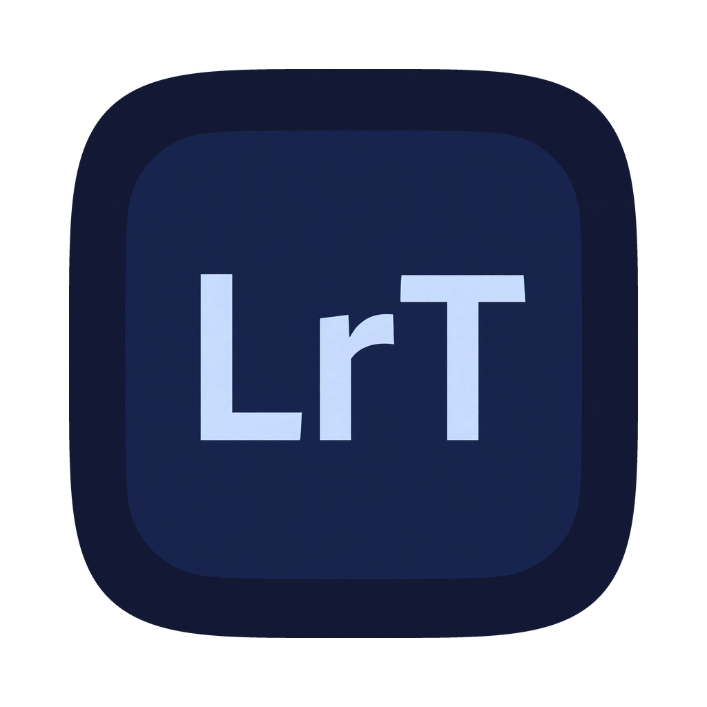

<p align="center">
  
</p>

<h1 align="center">Lightroom by Tony</h1>

<p align="center">
  <b>A personal fork of <a href="https://github.com/storytold/lightcraft">LightCraft</a> — rebranded and customized by Tony for his own use.</b><br>
  Not an official release. Personal use only.
</p>

## Origin

All of the original source code in this project is [LightCraft](https://github.com/storytold/lightcraft) by **storytold** — a photo library and RAW development application written in Rust, released under the **MIT / Apache-2.0** licenses (see `LICENSE-MIT` and `LICENSE-APACHE` in this repo, kept unchanged from the original).

This repository is **not** the official LightCraft and is not a public product release. It is a copy that Tony took, renamed to **Lightroom by Tony**, and adjusted with a few features for his own personal workflow. All credit for the original software belongs to storytold and the LightCraft contributors.

> "Lightroom" is a trademark of Adobe. This personal project is not affiliated with or endorsed by Adobe in any way; the name is used only for Tony's private use.

## What Tony changed

- **Name & identity**: the app is called "Lightroom by Tony", with its own **LrT** icon, About screen and macOS bundle.
- **JPEG Ultra HDR export** (a standards-compliant gain map with an HDR boost slider from 0 to 4), so photos posted to Instagram keep true HDR.
- **Pinch-to-zoom** with a two-finger trackpad gesture in the photo view.
- **Light/dark interface** (Settings → Interface → Theme).
- **Multi-select in the filmstrip** (checkmark circles, ⌘+click, Shift+click, All/None buttons) and **Copy Settings / Paste Settings as two separate buttons**; Paste applies to every selected photo.
- **Built-in self-update** (since 1.1.5): *Help → Check for Updates* — the app checks the Releases of this repo for the newest version, then downloads, builds and installs it on macOS by itself. Since 1.1.6 it also checks once at launch and, only when a newer version exists, asks with the release's changelog on screen.
- **HEIC photos work on macOS** (since 1.1.6): .heic files from an iPhone import, display and edit like any other photo, decoded by the operating system.
- **Missing-file prompt with verified relinking** (since 1.1.6): opening a photo whose original file was moved or deleted offers to locate it again — the candidate file is verified against the photo's content, so a same-name look-alike is refused — or to remove the photo from the library.
- **A proper macOS icon** (since 1.1.6): the LrT artwork sits in the standard squircle with the standard transparent margin, like every other app in the Dock.

## Installing on macOS

The Mac build is a source build, compiled with Cargo on Tony's own machine. In short:

```bash
cargo build --release -p lightcraft
packaging/macos/package.sh --arch aarch64
```

The DMG lands in `dist/release/`. Full instructions (clean install, removing the old build, Gatekeeper troubleshooting) are in `packaging/macos/HUONG-DAN.md` (in Vietnamese).

From **1.1.5** onward there is no need to repeat these steps for each new version: just open the app and click **Check for Updates**.

## License

Kept from the original project: **MIT OR Apache-2.0**. Tony's modifications in this repo are offered under the same terms, with the attribution above.
